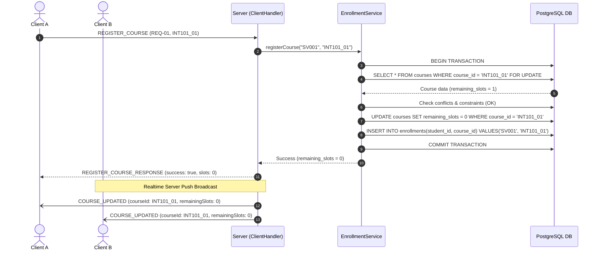
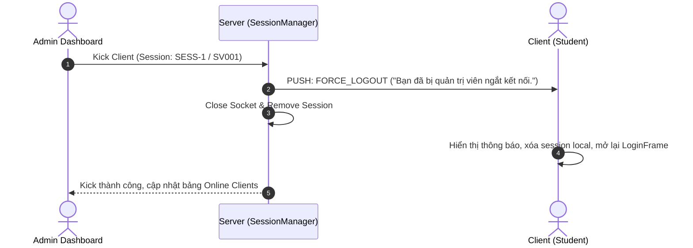

# KIẾN TRÚC HỆ THỐNG ĐĂNG KÝ HỌC PHẦN CLIENT–SERVER

## 1. TỔNG QUAN KIẾN TRÚC

Hệ thống được thiết kế theo mô hình **Client–Server phân tán** thuần Java (Java Core Sockets, Multi-threading, PostgreSQL JDBC, Swing UI, Jackson JSON), **không sử dụng bất kỳ framework backend nào** (như Spring Boot hay Hibernate).

```text
                         ┌─────────────────────────┐
                         │   PostgreSQL Database   │
                         │   (Port 5432)           │
                         └────────────▲────────────┘
                                      │ JDBC (HikariCP)
                                      │ PreparedStatement / Transactions
                         ┌────────────┴────────────┐
                         │      SERVER             │
                         │                         │
                         │ ServerSocket (Port 9999)│
                         │ ClientThreadPool (100)  │
                         │ ClientManager / Session │
                         │ ClientHandler (per conn)│
                         │ ProtocolHandler         │
                         │ AuthService             │
                         │ CourseService           │
                         │ EnrollmentService       │
                         │ BroadcastService        │
                         │ AdminService            │
                         └─────────┬───────┬───────┘
                                   │       │
                             TCP Socket  TCP Socket
                             JSON \n     JSON \n
                                   │       │
                      ┌────────────▼─┐   ┌─▼────────────┐
                      │   CLIENT 1   │   │   CLIENT 2   │
                      │ Swing GUI    │   │ Swing GUI    │
                      └──────────────┘   └──────────────┘

                         ┌─────────────────────────┐
                         │ Admin Server Dashboard  │
                         │ Swing GUI (Control/Log) │
                         └─────────────────────────┘
```

---

## 2. NGUYÊN TẮC CỐT LÕI (SOURCE OF TRUTH)

* **Server là Single Source of Truth**:
  - Quyết định tính hợp lệ của mọi yêu cầu đăng ký/hủy học phần.
  - Quản lý số slot còn lại của lớp học phần.
  - Quyết định xác thực, phân quyền (STUDENT / ADMIN).
  - Duy nhất Server được phép kết nối CSDL PostgreSQL.
* **Client chỉ là Presentation & Request**:
  - Không bao giờ chứa thông tin cấu hình hay kết nối JDBC PostgreSQL.
  - Không tự quyết định trừ slot hoặc cho phép đăng ký.
  - Giao tiếp với Server 100% qua TCP Socket theo giao thức JSON framing `\n`.

---

## 3. PHÂN TẦNG VÀ DÒNG CHẢY DỮ LIỆU

```text
[ Client Swing UI ]
        ↓ (Worker Thread / Background)
[ ClientService ]
        ↓
[ ClientSocketManager ]
        ↓ (TCP Socket JSON + \n)
[ ServerSocket / ClientHandler ]
        ↓
[ ProtocolHandler (Auth & Role Check) ]
        ↓
[ Server Services (Auth / Course / Enrollment / Admin) ]
        ↓ (ACID Transactions & SELECT ... FOR UPDATE)
[ Repositories (PreparedStatement) ]
        ↓
[ PostgreSQL Database ]
```

---

## 4. MÔ HÌNH ĐA LUỒNG (MULTI-THREADING)

### 4.1. Phía Server
1. **Accept Loop Thread**: Chạy vòng lặp `serverSocket.accept()` liên tục đón nhận các kết nối mới.
2. **Client Thread Pool (`ExecutorService`)**: Kích thước cấu hình tối đa 100 kết nối đồng thời. Mỗi socket kết nối được giao cho một thể hiện `ClientHandler` độc lập.
3. **Heartbeat Watchdog (`ScheduledExecutorService`)**: Định kỳ 10 giây quét qua danh sách session, phát hiện các kết nối mất mạng ngầm (quá 30 giây không gửi PING) để đóng socket và giải phóng session.

### 4.2. Phía Client
1. **Swing Event Dispatch Thread (EDT)**: Chỉ xử lý vẽ giao diện và phản hồi tương tác người dùng. **Tuyệt đối không thực hiện Socket I/O trên EDT**.
2. **Background Request Threads (`SwingWorker` / `CompletableFuture`)**: Gửi request qua mạng và nhận phản hồi đồng bộ/bất đồng bộ.
3. **Dedicated Reader Thread**: Một luồng chuyên biệt chạy nền liên tục đọc các dòng ký tự `\n` từ ServerSocket:
   - Nếu thông điệp chứa `requestId`: Khớp với `CompletableFuture` đang đợi để trả kết quả về UI.
   - Nếu là **Server Push** (`COURSE_UPDATED`): Cập nhật trực tiếp số slot trên `JTable` qua `SwingUtilities.invokeLater`.
   - Nếu là **`FORCE_LOGOUT`**: Đóng kết nối, hiển thị hộp thoại cảnh báo và đưa sinh viên về lại `LoginFrame`.
4. **Heartbeat Sender (`ScheduledExecutorService`)**: Gửi lệnh `PING` mỗi 10 giây để duy trì kết nối và giúp server nhận biết client còn sống.

---

## 5. XỬ LÝ CONCURRENCY & RACE CONDITION (BẢO VỆ SLOT CUỐI)

Khi 2 hoặc nhiều sinh viên cùng đăng ký 1 lớp học phần chỉ còn **1 slot duy nhất** (`remaining_slots = 1`), hệ thống đảm bảo **chính xác 1 sinh viên thành công** và **các sinh viên còn lại nhận `COURSE_FULL`**.

### Cơ chế kỹ thuật:
1. Giao dịch được thực thi với `Connection.setAutoCommit(false)`.
2. Khóa dòng bản ghi học phần bằng:
   ```sql
   SELECT course_id, subject_code, remaining_slots, max_slots, ...
   FROM courses
   WHERE course_id = ?
   FOR UPDATE;
   ```
3. Luồng nào chiếm được khóa dòng (Row-level lock) trước sẽ kiểm tra `remaining_slots > 0`.
4. Sau khi kiểm tra hợp lệ, luồng đó cập nhật `remaining_slots = remaining_slots - 1` và thực hiện `INSERT INTO enrollments (...)`.
5. Luồng đó thực hiện `conn.commit()`, nhả khóa dòng.
6. Luồng đến sau nhận được dữ liệu mới nhất với `remaining_slots = 0`, bị ném ngoại lệ `CourseFullException`, thực hiện `conn.rollback()` và trả mã lỗi `COURSE_FULL` cho client.
7. Đảm bảo bất biến CSDL:
   $$0 \le remaining\_slots \le max\_slots$$

---

## 6. SƠ ĐỒ TRÌNH TỰ (SEQUENCE DIAGRAMS)

### 6.1. Đăng ký học phần & Realtime Broadcast



### 6.2. Admin Kick / Force Logout


